 

---

### `$ whoami`

---

### `$ ls ~/toolkit`

---

### `$ ls ~/certifications`

Clique no painel para abrir o SVG diretamente e acessar os links dos certificados.

---

### `$ ./stats.sh`

---

 

